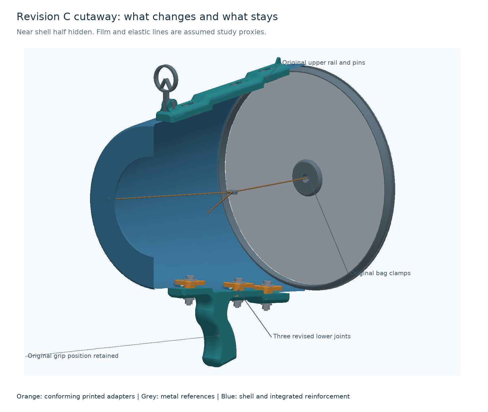

# Air-vortex cannon

**Current selected design: Revision C, conditional CAD prototype.** Keep the original grip position and upper rail/pins; change the three lower handle connections. The bag attachment, elastic arrangement and outlet retain their original designs. There is no physical cannon or measured print/strength/airflow result yet.



## Current work

- [Design choices, rejected handle movement and proof limits](design-c/README.md)
- [Selected print files and quantities](design-c/joints/print/README.md)
- [Small actual-interface fit coupon](design-c/joints/fit-coupon/README.md)
- [Selected 3D assembly](design-c/presentation/selected-rest.glb)
- [Independent review](design-c/review.md)
- [CAD/rebuild environment](design-c/ENVIRONMENT.md)

The fit coupon is the next physical check, after actual hardware and slicer inspection. It is not a strength specimen. No print, purchase or printer change has been performed.

## Asset map

| Location | Role |
|---|---|
| [Original mesh inventory](source/egordv/mesh-inventory.json) | The 17 immutable original meshes and inventory. |
| [Assembly recovery](assembly-study/README.md), [original mechanism](ancillary-study/README.md) | Source assembly, coordinates and evidence. |
| [Revision C](design-c/README.md) | Selected current CAD, exports, fit coupon, handle/load/movement studies and views. |
| [Revision B](design-b/README.md), [fastener alternatives](joint-study/README.md) | Previous six-joint candidate and native fastener studies; preserved history. |
| [Revision A](revision-a/README.md), [its challenge review](review-revision-a/review.md) | Earlier keeper experiment and the findings that prevented its promotion. |
| [Earlier loads](load-study/README.md), [usage](usage-study/README.md), [views](presentation/README.md) | Earlier studies/presentation and helpers used by current scripts. Their READMEs identify scope. |

[Import manifest](import-manifest.json) hashes the preserved asset copy. The original package manifests are historical evidence. Duplicate ZIP bundles, caches, unmanifested development leftovers and B's large optional HTML viewer were not imported; native 3D models and static views remain available. Existing internal paths are intentional so the reviewed relative-path code and records continue to work.

The rejected optional handle's oriented mesh is retained with its study, outside the selected print set. Historical review links containing `filename:line` use the original local viewer's line notation; browse the named file and line in GitHub. The old presentation's `usage-results.json` link names a superseded development result; its current accepted predecessor is [recommended-usage-results.json](usage-study/recommended-usage-results.json), while C's own current results are [here](design-c/usage/usage-results.json).

## Local modeling setup

Use Python 3.12 with the [tested project dependencies](requirements.txt) in a local virtual environment. Dependencies are not installed or bundled in Git. From this project directory, the current scene can be rebuilt with:

```sh
python design-c/assembly.py
```

Read the owning study instructions before rebuilding numerical evidence. Work in a disposable copy for fresh calculations; historical output/rebaseline records must remain intact. Old absolute task-workspace or Python/FreeCAD paths in preserved notes describe the preparation machine, not portable setup commands. The current geometry scripts derive their asset paths from the project directory; `/tmp/vortex-manifold` is an optional preparation fallback when Manifold is not installed normally. Gmsh/CalculiX are optional dependencies for replaying the old washer FEA, not for viewing the current CAD.

The original target printer was a Bambu Lab X2D, 0.4 mm nozzle, with a verified 256 × 256 × 260 mm bare main-hotend envelope. That is context for this project, not a global default for future builds. Profile/plate/support/filament validation remains outstanding.

## Sources and history

[Attribution and license](ATTRIBUTION.md) · [Maintained research note in Drive](https://drive.google.com/file/d/1JhqHNwLZDJjenkSKBQBPykGAqH5ffdi7/view)

CAD/assets are maintained in this repository after the 2026-10-26 import. Original task-workspace copies remain recovery/history; no originals were moved or deleted. The Drive note retains research and points here for current assets. Old local links within historical evidence are dated provenance.
