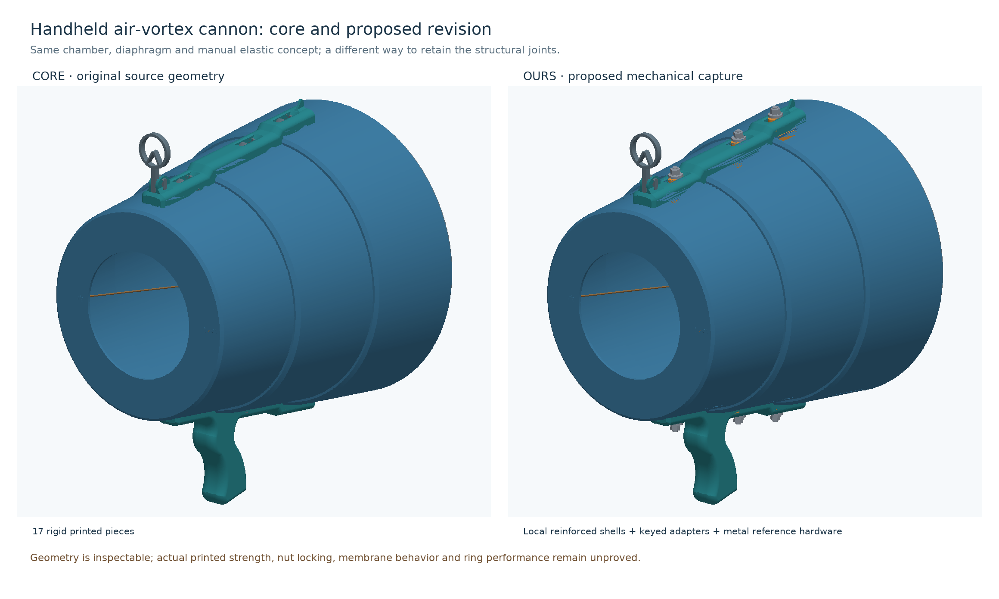

# Air-vortex cannon — core, recommended revision and options

**Engineering prototype, 2026-10-25.** This package models the complete household, handheld, manually operated air-only device. Eric confirmed that no physical cannon or measured pull data are available and authorized clearly stated load assumptions. Geometry, kinematics and conditional calculations can be checked digitally. Actual FDM strength, hardware seating/torque, friction, film slack, durability, sealing and vortex performance are not proved by those checks.

Whole CAD views and native 3D models: [presentation](../presentation/README.md). The [small actual-interface fit coupon](fit-coupon/README.md) supports a later trial before making the large shells.

## 1. Core design: preserve a traceable baseline

The core is [egordv's Air Vortex Cannon, profile 348811](https://makerworld.com/en/models/442826-air-vortex-cannon#profileId-348811), with all **17 original printed objects** reconstructed into a nominal assembly: three tapered shell sections, handle and top rail, six split clips, rear membrane clamp, two central pinch parts, carabiner, sight and sight axle. Original source meshes remain immutable under `../source/egordv/`.

The native assembly owner is [assemble.py](../assembly-study/assemble.py); [full-stock-assembly.json](../assembly-study/full-stock-assembly.json) records poses and evidence. Coordinates are millimetres: X horizontal/tangential, Y up, Z rearward from the outlet. GLB presentation files use metres. Source print-plate positions were not treated as assembly positions.

Mesh mating surfaces and the [designer's assembly video](https://www.youtube.com/watch?v=NKO3LCNGTJY) establish the following:

- The shell axial offsets are 0, 84 and 171 mm; the rear shell ends at Z259.88964 mm.
- Clips enter from inside the barrel, with broad heads inside and split tips outside through the shell and rail. Their insertion axes follow the 5.4923-degree cone normal.
- The six inner-shell-to-outer-rail stacks are approximately 11.008–11.019 mm. Small source slot mismatches are retained in the model.
- Two rubber bands attach at opposite front-annulus eyelets. A carabiner joins them to two further bands leading to the central rear membrane clamp. The junction position, rest lengths and stiffness remain assumptions.
- The sight is modeled in its corrected deployed pose. A wrong fore/aft pose was found and corrected during checking. The full folding path is **not qualified**: intermediate source poses have contact, even though some later isolated poses are clear.

The stock rear clamp and central pinch joint are flexible snaps. Their undeformed CAD has deliberate/interpreted interference; a rigid clearance model cannot prove their insertion or removal. The designer video is evidence of the intended assembly, not a strength rating for our prints.

**Why keep this core:** it gives a reproducible comparison and preserves the existing outlet, diaphragm concept and elastic topology. There is no evidence that a smaller aperture, longer barrel or stronger elastic would improve this particular household device.

## 2. Our suggested design: Revision B

The recommended *candidate* replaces the six flexible shell/rail clips with positively captured metal shoulder-bolt joints and reinforces the slot regions. It does not reuse Revision A's unretained keeper.

| Change | Reason | Tradeoff / limit |
|---|---|---|
| Six continuous inner collars, fused into the three shell copies | Adds actual material around each opening; it is not a loose washer credited with friction. | Requires three revised shell prints. The inward lower ledges require support/layer inspection and accessible cleanup. |
| One repeated keyed adapter, quantity six | Locates in the shell/rail opening and transfers in-plane loads through bearing rather than a flexible snap arm. | Running clearances and manufacturing error remain; no improved aiming stiffness is claimed. |
| D5 shoulder/M4 threaded metal bolt, with inner and outer steel washers and a locking nut | Head and nut-side washer provide geometric capture. The shoulder supplies a metal tightening stop under the stated idealized geometry. | More hardware and weight; actual shoulder transition, washer seating and torque must be checked. |
| Thicker outer washer, DIN 7349 nominal 1.6 mm | Addresses washer bending across the rail opening. A local FE study was run on its actual nominal and adverse-tolerance geometry. | FE results assume steel elasticity and rigid support patches, not a known purchased washer's capacity. |
| Keep outlet, band arrangement and original deployed sight | Avoids attributing airflow gains to a joint repair. | Ring coherence, leakage and sight calibration still need a baseline experiment. |

### Exact new geometry and hardware

Each collar has a rounded **32 × 24 mm** footprint, an inward flat landing 2.5 mm from the original inner tangent surface, and a recut **16.4 × 8.2 mm** opening. It overlaps the old wall by 0.30 mm before Boolean fusion. The load screen credits only **2.0 mm of effective collar bearing thickness**, not the entire nominal wall-plus-collar sum.

The repeated adapter has a **30 × 22 × 4.6 mm** base, a **15 × 7.4 × 13.4 mm** key, and a **5.4 mm** bore. Its base ends on the new flat collar landing. Print orientation places the flat base on the bed, bore vertical; total height is 18 mm. Native source: [build_recommended.py](build_recommended.py). STEP and STL exports are in `parts/`; selective manufactured meshes are in `print/`. Metal reference meshes are **not print parts**.

Per joint, the modeled hardware is:

1. One Elesa/Ganter-type **5-M4-20 shoulder screw**: D5 shoulder, L20, M4 thread length 8, head D9 × 4, 2.5 mm hex drive. [Manufacturer dimensions and tightening qualification](https://www.elesa-ganter.hr/siteassets/PDF/EN/ISO%207379.pdf).
2. One inner M5 wide steel washer: **ID5.3 × OD15 × 1.2 mm**. [Bossard dimensions](https://www.ruuvikeskus.fi/attachments/h7cpz.pdf).
3. One outer M4 heavy steel washer: **ID4.3 × OD12 × 1.6 mm**, DIN 7349. [Supplier dimensions and tolerances](https://www.accu.co.uk/metric-flat-washers/63172-HDTW-M4-A2).
4. One M4 locking-nut envelope: **7 mm across flats, 5 mm high**. [Bossard reference](https://www.tme.eu/Document/b2162b4e06623b32cc382f0f3f1ca4a6/B4_BN161.pdf).

That is **30 joint components across six sites**, including the six printed adapters, compared with six stock clips. There is no separate cut-to-length spacer and no outer printed pad. The assembled recommended device contains 17 printed parts plus 24 purchased metal reference parts; this is a reliability/serviceability tradeoff, not a claim of minimum cost or weight. No hardware has been purchased.

### Capture, clearance and tightening assumptions

The outer washer's ID is smaller than the shoulder diameter. With the outer washer seated at the shoulder end, its position is set by the metal screw rather than a tightening force through the plastic. The **dominant-rail-datum separation is 0.681–0.692 mm**, not exact free play. Independent washer-footprint probes find **0.741–0.760 mm travel to first contact** for nominal OD12 washers, and **0.775–0.820 mm** for adverse OD11.3 washers, because the local rail surface is recessed. Key tips remain slightly recessed at nominal first contact. Nominal thread projection beyond the modeled nut is 1.4 mm; real engagement and locking are not established by thread envelopes.

A dimensional sensitivity study assumes adapter thickness error ±0.15 mm, collar position ±0.15 mm, rail stack ±0.10 mm, inner-washer thickness ±0.10 mm, and the manufacturer's shoulder length tolerance 0 to +0.25 mm. These give **0.18–1.44 mm datum-plane separation**. Including the deterministic nominal/adverse washer-footprint contact travel gives an illustrative **approximately 0.24–1.57 mm first-contact range** before unmodeled shoulder-transition details. These are not statements of X2D accuracy or a guaranteed real free gap. Real shoulder undercuts/chamfers, washer seating, actual hardware tolerance and printed stack must be measured before tightening. No assembly torque is invented; the manufacturer explicitly says shoulder/transition bearing limits torque rather than strength class alone.

No friction or clamp preload is credited for resisting use loads. Captured play can affect stiffness and leakage. Positive capture therefore does not establish airtightness or improved aim.

## 3. What the CAD and other tools actually establish

### Geometry and manufacturing boundary

[Collar source](build_collars.py) generates editable CAD/STEP solids. [Mesh fusion](fuse_shells.py) combines them with copied original shells using Manifold 3.5.4, then recuts openings. The final shell meshes are each watertight, consistently wound and one connected material component after export/re-import. A 0.002 mm numerical simplification tolerance and explicitly bounded duplicate/degenerate-face cleanup are recorded in [validation.json](reinforced-shells/validation.json); the middle shell's numerical pinhole cap is approximately 5.7e-11 mm², not a modeled design opening.

Outer shell bounds remain unchanged. The three individual shell extents are approximately **203.76 × 203.76 × 87.67**, **229.40 × 229.40 × 90.22**, and **249.65 × 249.65 × 88.89 mm**. They fit the verified X2D main-hotend **256 × 256 × 260 mm** bare envelope. The largest leaves only about 3.18 mm per side before brims, skirts, supports or profile exclusions.

Both assembled-coordinate and final print-oriented STL exports are separately reloaded and checked for topology. Float32 duplicate/degenerate-face cleanup is recorded at each boundary; the selective print aliases match the validated exports. [Print file quantities and orientation](print/README.md).

**This is not a profile-verified print handoff.** The actual 0.4 mm printer/plate/filament project, collar support faces/removal, bores and neck layers still require slicer inspection. The collars' inward lower ledges are not assumed support-free. No print time, filament mass or actual layer strength is claimed, and no print has started.

### Usage and movement

The model includes the entire assembly, central cap/pinch movement, film envelope, observed band topology, deployed sight, six joint positions and inside/outside tool access. The study uses **0–60 mm** axial pull plus four off-axis endpoint cases corresponding to approximately ±10 degrees. These are assumed study values, not measured travel or a recommended maximum. Nominal thread projection and the chosen bolt/tool paths are checked separately from static placement; actual thread engagement, nut locking and human tool operation remain physical checks.

The film is a zero-thickness clearance surface. A 60 mm conical study pull needs **17.63% additional annular area** over the flat annulus. Actual bag slack, folds, film thickness, pressure and elastic constitutive behavior are unknown. The reported approximately 1.03 litre geometric sweep is not measured expelled air volume or a vortex-performance prediction.

The generic hand volumes are explicitly chosen proxies, not anthropometry or comfort validation. The stock grip proxy has only about 0.94 mm conservative sampled clearance from the middle shell under that choice; moving the grip upward is not accepted merely because the force-moment arithmetic looks better.

Final checks cover seven axial positions, four off-axis end positions, 12 tool positions, six rear-entry corridors and six bolt withdrawals against the actual fused shells, with no reported sample more than 0.02 mm inside a nonmating obstacle. Stronger continuous rigid-envelope bounds also pass for the central pieces and all 18 chosen tool/entry envelopes. Those bounds were independently checked for their mathematical and closed-mesh preconditions.

The top-rear exterior **OD12 mm tool body** has only **0.02994 mm** certified ideal-CAD margin, which is not robust physical access. A separately modeled **OD≤11 mm, 30 mm-long body for the 7 mm nut tool** gives a **1.01965 mm** continuous CAD clearance bound. Use that smaller-body requirement at the top rear and verify the real tool; no purchased socket, tool grip or tool-wall strength was validated.

See the [usage study](../usage-study/README.md) for final clearance records, semantic input provenance and counterexamples. A successful sampled path or rigid-envelope certificate does not prove all continuous deforming behavior. Original central and rear snap deformation and the sight's intermediate folding contacts remain unresolved source interfaces.

### Loads and finite elements

[Load study and independent audit](../load-study/README.md) uses 1 N normalization and illustrative 5/10/20 N manual pull cases, a separate 40 N transient sensitivity, ±10-degree pulling, gravity/inversion and adverse connection participation. Body mass is an assumed 0.6 kg scenario. Its force-application point uses an additional **80 mm aft-travel assumption**, separate from the **0–60 mm clearance study**; neither is measured maximum travel. It does not divide load by six, infer measured band force, or claim an impact/fatigue rating.

Across the analyzed planar cases, the largest demands are approximately **115.81 N normal** and **30.41 N tangential** at a connection. This occurs in the adverse case with only the middle/rear lower connections participating. Under the simple nominal screens, 2 mm collar-only bearing demand is approximately **2.05 MPa** and 4.6 mm adapter beam-proxy bending demand approximately **2.74 MPa**. These are calculated demands, not verified printed allowables; local notch, layer, contact and creep effects remain.

Forty-two 3D frictionless contact-equilibrium cases also test whether the assumed finite bearing faces can balance the applied wrench. Their feasible force distribution is optimistic; it is not stiffness-selected load sharing or a safety factor.

Actual local **Gmsh/CalculiX linear-elastic FE analyses** were run for nominal 1.6 mm and adverse-tolerance 1.3 mm outer washers at two mesh levels. They use steel E200 GPa, Poisson ratio 0.3, and stated nut/rail bearing patches. Those planar rigid support strips are an idealization, not recovered conforming rail contact. At the 115.81 N normal demand, nominal/adverse bulk stress measures are about **29.2/43.3 MPa**, and maximum displacements about **0.00104/0.00176 mm**. Sharp support-boundary peaks remain mesh-sensitive; those peaks are not a converged yield proof. Unknown actual washer grade prevents a capacity rating. Equilibrium and FE integration-point stresses were independently recomputed.

**Proof boundary:** the calculations demonstrate the behavior of the declared mathematical models. They do not prove the manufactured cannon safe or durable, nor establish greater range, ring coherence, sealing or comfort. Remaining whole-load-path uncertainties include collar/key roots and layer bonds, the unchanged handle/rails and front elastic eyes/central loop, clearance-closing impact/creep and actual film/band routing. The inherited core also has small nominal rigid overlaps at some rail/shell seams, sampled up to about 0.13 mm; these remain source-fit/compliance uncertainties rather than regressions from the new collars.

## 4. Optional adjustments, with their status

| Option | Why consider it | Why it is not part of the qualified recommendation |
|---|---|---|
| Tune adapter base thickness after measuring the real captured stack | Can reduce unwanted play while preserving a positive metal stop. | Must retain a measured positive gap at every site; blindly thickening the adapter can clamp/crush plastic. Change the local CAD dimension, not overall scale. |
| Slimmer top-rear nut-tool body | The OD≤11 mm modeled option improves the ideal continuous clearance bound from about 0.03 mm to about 1.02 mm. | It is a geometric tool-size requirement; actual tool reach, dimensions and operation still need checking. |
| Fully printed coarse-threaded stud/nut | Fewer purchased parts and easier local sourcing. Native helical CAD is in `../joint-study/parts/`. | Those are architecture-study parts, not final six-site fit exports. Thread fit, back-off, creep and FDM strength are unqualified. |
| Calibrate the original deployed sight | Can correct a systematic aiming offset at a chosen household distance. | It cannot establish better shot-to-shot spread or coherence. Full folding remains unqualified. |
| Diaphragm slack/template and centred release trials | Targets pulse repeatability without increasing elastic. | Actual film slack and motion must be measured; a hard stop or guide is not automatically beneficial. |
| Seal and outlet experiments | May reveal a useful next bottleneck after a sound baseline. | Leakage and ring structure have not been measured. Preserve the original outlet first, change one feature at a time, and separate target response from coherence. |
| Higher grip / one-piece body | Could reduce moment or eliminate joints in a different architecture. | Current hand proxy has little shell clearance; the full stock body is nearly 260 mm long. Neither is accepted on handling/build-volume arithmetic alone. |

## 5. Smallest physical acceptance sequence

No print or purchase has been started. For later physical validation: first obtain the actual hardware and filament specifications, inspect the intended 0.4 mm slice/support removal, then test one complete joint coupon including actual shell/collar/rail surfaces. Check fit, measured free gap, retention, tool access, unloaded removal and repeated unchanged intended loading. Verify all distinct installed positions before whole-unit operation. Compare the sound stock arrangement and revision where useful; reject cracking, spreading, damage, progressive motion or inaccessible service.

Only after the assembly is sound should modest paper-target trials evaluate repeatability, aim and diaphragm behavior. Actual load/strain/durability evidence and film slack remain required before describing the manufactured design as proven. Keep adult assembly/supervision, an empty chamber and the original air-only scope. This project contains no compressed-gas tank, combustion, projectiles, smoke/fog chemicals, purchases, print or high-power optimization.

## Source ownership and reuse

Base design: egordv, MakerWorld profile 348811, captured CC BY-NC-SA 4.0. New collars, adapters, assembly models, studies and handoff are a derivative for Eric Feunekes prepared with Codex, offered under [CC BY-NC-SA 4.0](https://creativecommons.org/licenses/by-nc-sa/4.0/). Hardware reference shapes were modeled from cited dimensions; no supplier CAD asset or separately restricted community lock was copied. Source meshes and Revision A remain separate evidence.
