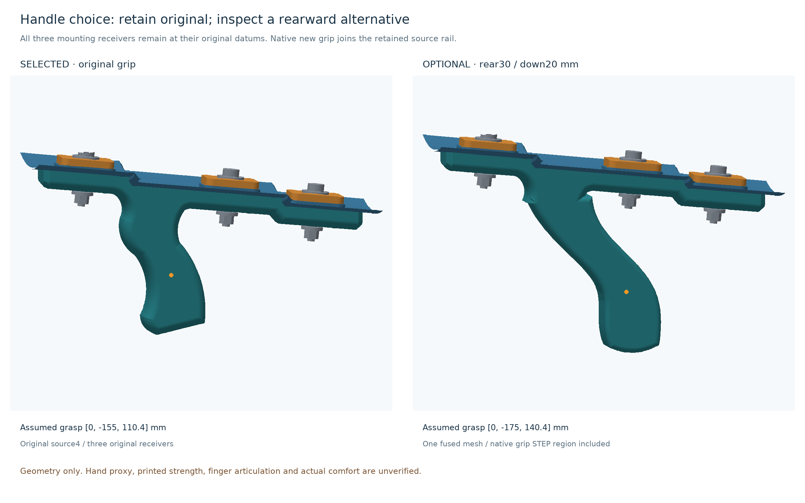
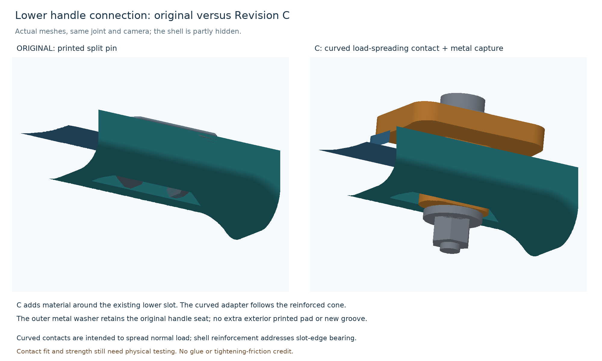

# Revision C — handle investigation and lower-only attachment candidate

**Conditional CAD prototype, 2026-10-26.** Retain the original grip position and upper rail/pins. Concentrate the structural candidate on the three lower handle connections, using conical shell reinforcement and matching curved keyed adapters. The rearward handle was modeled and is retained as a rejected comparison study. No physical cannon, measured pull data, print or purchase is represented.

## Why the handle stays

Moving the assumed grasp 30 mm rearward at the same height improves upright holding balance. It does not shorten the vertical lever arm of an axial pull or automatically reduce the barrel-to-handle reactions.

The hardware introduces a packaging tradeoff. Same-height rearward positions overlap the chosen hand ellipsoid. One evaluated alternative, rearward 30 mm and downward 20 mm, clears that volume but increases the pull lever arm and blocks the middle exterior nut-tool path. This is not proof that an actual articulated hand cannot fit; it prevents a demonstrated-comfort or service-access claim.

| Evaluated grasp | Illustrative 20 N axial pull + upright weight | Decision |
|---|---:|---|
| Original | 3.274 N·m hand-couple magnitude | Selected reference. |
| Rear 30 mm, same height | 3.098 N·m, about 5.4% lower | Chosen hand volume conflicts with middle hardware. |
| Rear 30 mm, down 20 mm | 3.498 N·m, about 6.8% higher | Hand volume clears; middle nut-tool access conflicts. Rejected as default. |

The mass is an assumed 0.60 kg at COM Z140 mm. Grasp points are original XYZ[0,-155,110.4] and alternative [0,-175,140.4] mm. These are not measured operating or comfort values. A uniform-solid accounting puts the original CAD centroid at Z135.16 mm, but excludes infill, film, bands and C changes. Inverted/off-axis and mass/COM sensitivities show further tradeoffs. The [ergonomics study](ergonomics/README.md) gives equations, sensitivities and independent checks. Including hand force and couple preserves the wrench at a fixed root: a smaller hand couple alone is not proof of lower root bending.

## What changes

- Keep the original handle, upper rail and pins 11–13. Replace only lower pins 14–16.
- Add one continuous conical collar around each lower shell slot, integrated into copies of the three shells.
- Add three location-specific keyed adapters with curved contact faces and flat inner metal-washer seats. The 0.05 mm normal gap is a native CAD parameter; separately tessellated exports can touch sooner. It is not a demonstrated manufacturing fit.
- Keep positive shoulder-screw capture: D5/L20 shoulder, M4 thread, inner M5 washer, outer heavy M4 washer and M4 locking nut.
- Preserve the original shell apertures without deliberate enlargement. A smaller aperture in the added collar engages the key nominally before the thin old edge. No new surrounding groove or glue joint is introduced.

Loose curved saddles were considered. They can spread normal pull-through loading but do not automatically thicken the slot edge carrying sliding load. Depending on tightening friction introduces plastic compression and creep. Continuous reinforcement therefore remains selected. An exterior printed saddle was omitted because it adds a part without establishing broad contact at the existing recessed handle seat; the metal washer retains limited contact patches there.

The assembly has **17 printed pieces plus 12 metal reference pieces**, compared with B’s 17 plus 24. The three adapters differ with cone radius. Bag retaining ring, centre pinch parts, pull loop, elastic arrangement and outlet retain their original designs. Added internal geometry may affect airflow; no benefit or neutrality is claimed.

## Models and verification

- [Lower CAD and print/contact handoff](joints/README.md): native build123d source, STEP ingredients, actual fused shell STLs, three adapter STLs and contact records.
- [Handle investigation](handle/README.md): original receivers, native optional grip region and fused comparison mesh. Optional handle is not selected or service-qualified.
- [Usage/service study](usage/README.md): actual C rigid assembly and assumed pull/tool envelopes.
- [Load/moment study](ergonomics/README.md): signed hand moments and C nominal joint-demand screen.
- [Independent review outcome](review.md): accepted corrections and remaining physical limits.
- [Selected 3D model](presentation/selected-rest.glb), [60 mm pull study](presentation/selected-pull-60mm-study.glb), [rejected handle study](presentation/optional-rear-grip-study.glb).

CAD/STL/JSON use millimetres; GLB uses metres. `assembly.py` consumes actual CAD exports for all views/scenes. Source mesh shells are not editable STEP BREP: their owner is the original mesh plus parametric CAD/Boolean procedure.

Exact Boolean probes found no material intersections between the new adapters and the original/fused shell, collar or handle. Original slots and upper features receive no deliberate cuts. Mesh simplification/export uses a recorded 0.002 mm simplification parameter; exported source copies are not mathematically identical. Independent source-upper-vertex probes found maximum deviations about 0.0031 mm. Downloaded originals and the reviewed B package remain unchanged.

The C usage run checked seven axial positions, four off-axis endpoints, six tool positions, three rear-entry paths and three bolt withdrawals against all 26 fixed rigid obstacles. No reported sample penetrated more than 0.02 mm; tiny nominal withdrawal contacts remain recorded. All nine continuous rigid-tool/entry bounds were positive, with the smallest about 1.55 mm. Rigid moving-piece radial envelopes also cleared. Film, bands, actual flexible snap release and real hands/tools retain the study's explicit limits. All 43 usage input hashes matched before, after and at final verification.

The C load screen reuses the inherited external-demand scenarios at retained mounts, not B capacity. It reports about 115.8 N peak normal and 30.4 N axial demand. Crediting 2 mm continuous collar bearing gives nominal 2.05 MPa; a simple bridge proxy using the new sampled adapter thicknesses gives 3.43 MPa and about 0.0087 mm deflection at assumed E = 1000 MPa. These are demands, not actual FDM allowables, safety factors or solved curved-contact/layer behavior. Local thickness is lower than B's flat 4.6 mm base, so B's adapter result was not copied. B washer FEA does not automatically qualify C contact.

## Later physical checks

Selected new print pieces are three lower-reinforced shells and three adapters; other printed pieces remain original. Collar ledges need slicer support/layer and cleanup inspection. The largest shell is about 249.65 × 249.65 × 88.89 mm, within the verified X2D 256 × 256 × 260 mm bare envelope, leaving only 3.18 mm per side before brims/supports/exclusions. No slice estimate, profile-bearing 3MF or support-free claim is supplied.

Use the new C actual-interface fit coupon before the large shells, rather than B's flat-seat coupon. Cut free edges change stiffness: it is not a strength/fatigue specimen. Check actual shoulder/washer/printed stack, locking engagement, tool access, retention, unloaded removal and all installed positions. Do not use tightening to erase clearance without verifying the metal stop.

Actual printed roots/layers, seating, creep/cyclic/impact behavior, original rails/upper snaps, film slack, flexible clamps, hands/tools, sealing and vortex performance remain physical gates. Digital clearance and equilibrium do not prove manufactured durability or child-use suitability. No stronger elastic, larger stroke, range optimization, print, purchase or printer-state change occurred.

Base: [egordv / MakerWorld profile 348811](https://makerworld.com/en/models/442826-air-vortex-cannon#profileId-348811), CC BY-NC-SA 4.0. C modifications use the same terms. No separately restricted community-lock geometry was used.
