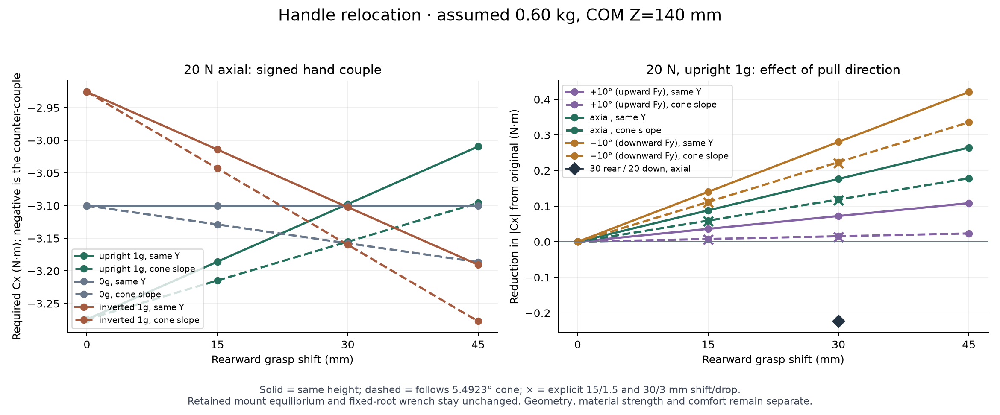

# Handle position investigation

**Retain the original grasp as the default unless a revised attachment gives a rearward grasp with enough hand clearance and little extra drop.** A 30 mm rearward shift has a useful upright holding-balance effect under the published assumptions. It does not automatically reduce the axial-pull moment, the barrel-to-handle joint reactions, or bending at a fixed handle root. The geometry lane's 30 mm rear / 20 mm down alternative gives up more pull leverage than it gains in upright balance at 10 and 20 N. It is a review alternative, not an ergonomic improvement established by this analysis.

This directory is a bounded, reproducible supplement. `load-study/` was read without running or editing its scripts. No force, comfort, material, fatigue, aim or vortex-performance rating follows.



## Inputs and signs

Coordinates are mm, X horizontal, Y up, Z rearward. The original assumed grasp is **`[0,-155,110.4]`**. The retained rear plane is Z=259.889640808 mm. To compare with the published load study, the assumed force point remains `[0,0,339.889640808]`, 80 mm behind that plane. This is a force-application assumption; the separate usage study's 0–60 mm motion range remains separate.

The nominal body assumption is 0.60 kg at `[0,-20,140]` mm, g=9.81 m/s². Axial pull cases are 5, 10 and 20 N. The 20 N ±10° cases are in the Y/Z plane, with positive angle producing upward Fy. Gravity factors are +1 upright, 0 without weight, and −1 inverted; −1 reverses gravity in the object's coordinates. Chosen mass comparisons `[0.4,0.6,0.8]` kg and COM Z comparisons `[110,140,170]` mm are explicit sensitivities, not measurements, probability distributions or bounds.

For applied forces **on the cannon**, define external force `F = ΣF_i`, external moment about origin `M_0 = Σ(r_i × F_i)`, and grasp `H`. The supporting hand must apply:

```text
F_hand = −F
C_hand(H) = −Σ((r_i−H) × F_i) = −M_0 + H × F
ΔC_hand = ΔH × F
```

The reported signed Cx follows the right hand rule. Negative values below are the counter-couple required against the modeled pull. In this planar case:

```text
Cx[N·mm] = Yh Fz + (Zpull−Zh) Fy − (Zcom−Zh) m g s
```

Here `Fy` and `Fz` are the **pull force components**, and `s` is the gravity factor; total external Fy also includes weight. For a rearward shift ΔZ at the same height:

```text
ΔCx = ΔZ (m g s − Fy)
```

Following the cone lowers the hand by `ΔZ tan(5.492324557°)` and adds `−ΔZ tan(α) Fz` to ΔCx. At 30 mm rearward this drop is 2.884615 mm. A grip shifted rearward at unchanged height does **not** shorten the 155 mm perpendicular lever arm of a purely axial pull. Its nominal upright improvement is the gravity contribution. A lower grip lengthens that pull lever arm.

## Quantified comparisons

The table gives **signed hand Cx in N·m**, upright 1g, 0.60 kg, COM Z=140 mm. Values are rounded; `results.json` retains full precision and all cases. The first two families compare every requested shift. The last four rows isolate possible clearance-driven drops; their presence is not a fit or comfort endorsement.

| Rear / down (mm) | Grasp Y / Z (mm) | 5 N axial | 10 N axial | 20 N axial | 20 N +10° | 20 N −10° |
|---|---|---:|---:|---:|---:|---:|
| 0 / 0 original | −155 / 110.4 | −0.9492 | −1.7242 | −3.2742 | −2.4301 | −4.0241 |
| 15 / 0 | −155 / 125.4 | −0.8609 | −1.6359 | −3.1859 | −2.3939 | −3.8838 |
| 30 / 0 | −155 / 140.4 | −0.7726 | −1.5476 | −3.0976 | −2.3577 | −3.7434 |
| 45 / 0 | −155 / 155.4 | −0.6844 | −1.4594 | −3.0094 | −2.3215 | −3.6030 |
| 15 / 1.4423 cone | −156.4423 / 125.4 | −0.8681 | −1.6504 | −3.2148 | −2.4223 | −3.9122 |
| 30 / 2.8846 cone | −157.8846 / 140.4 | −0.7871 | −1.5765 | −3.1553 | −2.4145 | −3.8002 |
| 45 / 4.3269 cone | −159.3269 / 155.4 | −0.7060 | −1.5026 | −3.0959 | −2.4068 | −3.6882 |
| 15 / 1.5 | −156.5 / 125.4 | −0.8684 | −1.6509 | −3.2159 | −2.4235 | −3.9133 |
| 30 / 3 | −158 / 140.4 | −0.7876 | −1.5776 | −3.1576 | −2.4168 | −3.8025 |
| 30 / 10 | −165 / 140.4 | −0.8226 | −1.6476 | −3.2976 | −2.5547 | −3.9403 |
| 30 / 20 | −175 / 140.4 | −0.8726 | −1.7476 | −3.4976 | −2.7517 | −4.1373 |

At 20 N upright, rear 30 / same height reduces |Cx| by **0.17658 N·m, 5.39%**. Following the cone reduces it by 0.11889 N·m, 3.63%. The explicit rear 30 / down 3 sensitivity saves 0.11658 N·m, 3.56%. The hardware-clearance alternative rear 30 / down 20 **increases** it by 0.22342 N·m, 6.82%; at +10° it increases |Cx| by 0.32153 N·m, 13.23%. At 5 N that lowered alternative still saves 0.07658 N·m because the added pull-lever penalty is smaller.

Orientation exposes the tradeoff. The following values are signed Cx at 20 N axial:

| Grasp | Upright 1g | 0g | Inverted 1g |
|---|---:|---:|---:|
| Original | −3.27423 | −3.10000 | −2.92577 |
| Rear 30 / same height | −3.09765 | −3.10000 | −3.10235 |
| Rear 30 / cone slope | −3.15534 | −3.15769 | −3.16005 |
| Rear 30 / down 20 | −3.49765 | −3.50000 | −3.50235 |

Same-height rearward movement has no 0g axial benefit and increases the inverted axial hand-couple magnitude. With upward off-axis pull, rearward movement also shortens the lever arm of the upward force that otherwise assists the weight. At 20 N +10°, 30 mm rearward following the cone saves only 0.01558 N·m for 0.60 kg; at 0.40 kg it **increases** |Cx| by 0.04328 N·m. There is no improvement across all stated orientations and masses.

For weight-only holding, rear 30 brings the nominal grasp Z=140.4 almost onto assumed COM Z=140: signed Cx changes from −0.17423 to +0.00235 N·m. That is a balance result for this assumed COM. At COM Z=110 the original is already almost balanced and the same rearward move makes the holding moment worse. At COM Z=170 a larger rearward move still approaches balance. This is why pull cases and COM evidence must accompany a holding-balance argument.

## Stock geometry centroid check

`stock_geometric_centroid.py` applies the exact recovered assembly transforms to all 17 original meshes and sums each component's signed solid volume and volume centroid. All 17 are closed, consistently wound, positive valid volumes; their transforms match the saved assembly exactly. This is **uniform-solid geometry**, with component overlap counted additively. It does not include slice/infill choices, film, bands, hardware, Design B/C changes, or a measured mass distribution.

| Geometric accounting group | Additive volume (mm³) | Centroid XYZ (mm) |
|---|---:|---|
| All 17 original components | 424,834.297 | `[0.000192,-16.373742,135.157864]` |
| Original handle 4 only | 91,431.480 | `[0.004288,-133.469310,114.352754]` |
| All except handle 4 | 333,402.818 | `[-0.000932,15.738227,140.863401]` |
| All except handle and its three lower clips | 329,899.339 | `[-0.000079,17.058955,140.959434]` |

The whole-stock proxy puts a fixed-COM holding-balance target at **24.758 mm rearward**, rather than the assumed-COM target of 29.6 mm. At the same 0.60 kg mass, original weight-only Cx becomes −0.14572 N·m, versus +0.03086 N·m at rear 30: a smaller but still useful holding benefit. The 20 N upright original / same-height rear 30 values become −3.24572 / −3.06914 N·m. Rear 30 / down 20 becomes −3.46914 N·m, again worse than original under pull.

For completeness the JSON also carries a separately labelled full-density reference, 0.543788 kg using the prior study's 1.28 g/cm³ density. It must not replace the 0.60 kg operating assumption. A changed handle alters its own COM and total COM; holding the original stock centroid fixed is an explicit comparison, not updated Design C mass properties. The original handle accounts for about 21.52% of the stock solid volume, so this distinction matters.

The optional built handle has volume 110,345.249 mm³ and centroid `[0.003332,-142.774451,125.533379]` mm. Replacing only handle 4 in the stock additive geometry gives total volume 443,748.067 mm³ and centroid `[0.000129,-23.678555,137.051339]` mm. Its fixed holding-balance target is then 26.651 mm behind the original grasp. This handle-only replacement comparison still excludes the revised lower collars, adapters and metal hardware; the selected original grip is unchanged.

The handle producer subsequently added C collision checks, STEP-roundtrip details and a middle-tool service limitation to its validation metadata. The [semantic rebaseline](joint-screen-semantic-rebaseline.json) preserves the old handle-validation input hash `d853f24c…`, records the current `a8b2b08b…` hash, and verifies that current volume, centroid and grasp values reproduce every preserved handle-only stock-accounting result exactly. `results.json` remains byte for byte unchanged. This accepts the accounting provenance while retaining the new limitation: the optional grip blocks the assumed middle exterior R6 × 30 mm tool envelope and is not a service-qualified recommendation.

## Joint and handle-root distinction

The old planar model solves `A q = −W_external` from barrel-side external force and moment and the retained lower mount positions. **The hand point is absent from this solve.** Its hand moment calculation is separate. The old 3D contact model also has no hand point. An independent 3D cross-product replay reproduced all 14 exported hand moments; the largest stored reaction-equilibrium residual was about 8×10⁻¹¹ in its respective force/moment units. There was no grasp-point double counting to fix in those scripts.

For any fixed handle root J, the full required hand wrench obeys:

```text
C_hand(H) + (H−J) × F_hand = −M_0 + J × F
```

The right side is independent of H. Therefore lower hand couple alone does **not** prove lower bending at an unchanged root. It also does not establish lower forces at the retained three barrel-to-handle mounts. New handle shape can change local section stresses, grip contact forces, compliance, capture clearance and actual sharing among mounts, but those require geometry and stiffness evidence. Removing part of the required hand couple from a root or mount calculation would omit part of the load path.

This supplement checks that distinction across all 1,944 chosen combinations: maximum fixed-root moment difference was below 10⁻¹² N·mm and maximum recomputed retained-mount force difference below 10⁻¹⁴ N, at numerical rounding scale. The old equal-point-stiffness sharing remains a hypothesis rather than an actual-sharing bound. Its assumed whole body weight is assigned to the barrel-side free body; a refined split-body analysis should separately account for the redesigned handle's weight and the barrel-side weight instead of treating every gram as crossing the mounts.

## Bounded final C lower-joint demand screen

`screen_final_lower_joints.py` reads the frozen `../joints/lower-assembly.json` and reuses the prior study's fourteen stored planar load cases as **assumed demand only**. It confirms that the three mount points and their axial/normal frame directions are retained. The inherited cases include the separately labelled 40 N transient example and pair-participation sensitivities; these are not permission to operate with missing or loose joints. Actual sharing may change with new contact, stiffness and clearance. The planar reactions are not a complete 3D contact solution for C.

The nominal axial slot-bearing screen credits **2.0 mm continuous collar thickness × 7.4 mm key bearing width**. It does not add the original source wall or claim the full 2.5 mm inward collar offset as validated bearing thickness. The opening is now 15.6 × 7.8 mm. For the simple adapter bridge comparison, span=7.8 mm, net strip width=`30−5.4=24.6` mm, and thickness is each producer-exported **minimum sampled** curved-body value. The equations are `σ=3 Fn span/(2 width t²)` and `δ=Fn span³/(4 E width t³)`.

| Lower joint | Sampled thickness (mm) | Peak normal demand (N) | Peak axial bearing demand (MPa) | Peak bridge bending proxy (MPa) | Bridge deflection at assumed E=1000 MPa (mm) |
|---|---:|---:|---:|---:|---:|
| Front | 3.91035 | 42.7697 | 1.57357 | 1.33032 | 0.003450 |
| Middle | 3.98699 | 106.8100 | 2.05459 | 3.19575 | 0.008128 |
| Rear | 4.00832 | 115.8127 | 1.22077 | 3.42833 | 0.008673 |

Each column is the maximum for that site across the stated support/load cases; the peaks need not belong to one single operating state. E=500 MPa doubles the tabulated deflections; E=1500 MPa multiplies them by two-thirds. These moduli are chosen sensitivities, not measured printed material properties. The JSON retains the contributing case and support group for every demand.

The model's flat, simply-supported one-way strip does not solve the actual curved contact. The **native CAD design gap** is 0.05 mm; it is not a uniform exported-STL clearance. Independent mesh first-overlap probes along the outward normal are approximately 0.0138 / 0.0133 / 0.0163 mm at front / middle / rear. The real contact distribution develops as clearance closes and parts deform, and physical fit remains untested. Sampling does not prove a global minimum CAD thickness or a printed minimum. These numbers do not establish collar-transition stresses, key-root stresses, bore bearing, shell stability, washer seating, creep, layer adhesion, fatigue, or physical capacity. The prior Design B finite-contact capacities and steel-washer FE results **do not transfer automatically** to C's curved/recessed receiver contact. There is no allowable-stress comparison or pass/fail rating here.

All 98 inherited demand rows balance their stated planar wrench within 8.1×10⁻¹¹ in the respective force/moment units. Reprojection into the final frames agrees with the old normal/axial values within 1.5×10⁻¹⁴ N. The frozen manifest SHA256 is recorded in the demand JSON, and all input hashes were unchanged through the run.

The producer subsequently clarified source-export differences and the native-gap / exported-STL distinction in manifest metadata. The original numerical screen is preserved byte for byte, including its original manifest input hash `3895b3e3…`. [The explicit semantic rebaseline](joint-screen-semantic-rebaseline.json) accepts final manifest `a929c43c…` after verifying all 57 STEP/STL hashes, all three consumed mount frames and sampled thicknesses, aperture/key/bridge dimensions, and all 98 world-reaction rows are unchanged. It records both full hashes and the producer's metadata-change evidence. No numerical grid or CAD solve was rerun, and no numerical or capacity claim was added.

## Geometry and recommendation limits

The geometry lane reports that retained protruding lower hardware interferes with the translated example hand ellipsoid at the same height. The evaluated rear 30 / down 20 point is `[0,-175,140.4]`; its clearance evidence belongs to the CAD lane. The small cone/3 mm drops in this numerical comparison cannot be called feasible from moment calculations alone. No higher grasp is proposed. A +1 mm Y change at fixed Z would algebraically reduce the negative 20 N axial couple magnitude by 0.020 N·m, but it is not a candidate until real hand and hardware clearance are demonstrated.

Keep the original grasp as the default for the retained hardware. The optional lowered/rearward handle can be inspected for its holding-balance benefit, with its pull penalty and blocked assumed middle-tool envelope stated. A future geometry that clears a modest rearward shift at nearly the original height would justify a new comparison; it would still carry the inverted and off-axis tradeoffs. Material strength, layer orientation, root sections, hand sizes, finger articulation, wrist posture, contact comfort and actuation dynamics remain unresolved by these statics.

## Reproduction and outputs

To inspect and verify the preserved numerical history against the final metadata, run **only** this bounded rebaseline command from this workspace. It updates the semantic sidecar and does not overwrite numerical results. No installs are needed:

```sh
PYTHONDONTWRITEBYTECODE=1 \
  '/Users/ericfeunekes/ai notes/home/.scratch/power-bar-pegboard/venv/bin/python' \
  design-c/ergonomics/rebaseline_joint_screen.py
```

For a fresh numerical reproduction, first make a separate copy of the workspace. In that copy, run `stock_geometric_centroid.py`, then `analyze_handle_position.py`, then `screen_final_lower_joints.py` with the same Python environment and `PYTHONDONTWRITEBYTECODE=1 MPLCONFIGDIR=/tmp/vortex-mpl`. Those scripts intentionally regenerate their output files and record the **current** input hashes. Do not run them over this preserved historical bundle. Do not run the historical semantic-rebaseline recipe on freshly regenerated records: its purpose is to prove the original records survive the metadata transition.

`parameters.json` owns the explicit scenarios. `results.json` contains signed moments, forces, sensitivity cases, stock-centroid comparisons, prior-result replay, and read-only input hashes. `summary.json` gives nominal 20 N comparisons and numerical checks. `final-lower-joint-demand-screen.json` contains the final C geometry's separate nominal section screens; its original bytes are deliberately retained. `rebaseline_joint_screen.py` verifies the metadata-only amendment without regenerating that prior screen. The PNG is generated from the same solved hand cases. The analysis and joint-screen scripts hash their published inputs before and after and assert that they remain unchanged. To preserve the recorded history, inspect the existing numerical screen plus semantic rebaseline instead of overwriting the numerical screen in place.
