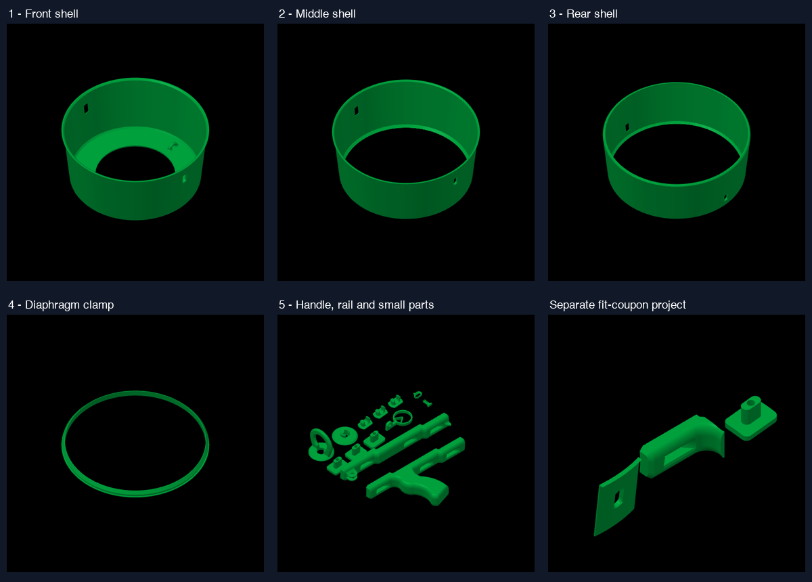

# Revision C — Bambu Studio projects

Open [air-vortex-cannon-revision-c.3mf](air-vortex-cannon-revision-c.3mf) **as a project** in Bambu Studio 2.8.2 or later. It contains the complete selected Revision C: **17 separate printed parts, quantity one each, on five plates**. Geometry, scale and the previously proposed print orientations are retained; only placement changes. Metal hardware, bag/elastic proxies and the rejected handle are excluded.

| Plate | Contents |
|---|---|
| 1 | Front reinforced shell 6 |
| 2 | Middle reinforced shell 8 |
| 3 | Rear reinforced shell 7 |
| 4 | Original rear diaphragm clamp 10 |
| 5 | Original handle, upper rail, sight/centre pieces, three original upper pins and three distinct C curved adapters: 13 pieces |



The separate [revision-c-fit-coupon.3mf](revision-c-fit-coupon.3mf) contains the actual-interface shell coupon, original receiver coupon and front adapter on one plate. This is the useful first physical fit check; it is not a strength specimen. Follow the [coupon instructions](../joints/fit-coupon/README.md) with the specified actual hardware.

## Proposed setup

The embedded machine is **Bambu Lab X2D, 0.4 mm nozzle**, with **Textured PEI Plate and Generic PLA**. The proposed process uses 0.16 mm layers, four walls, five top/bottom layers, 25% gyroid infill, normal automatic supports from the build plate, bridge-support omission, and a 2 mm outer brim with 0.1 mm object gap. The green display color is a placeholder; select the actual available spool, with a visible color helpful for finding small pins. No extra color changes are required.

Confirm the actual machine, nozzle, plate and spool before re-slicing. Keep scale at 100% and retain the orientations. Inspect supports and their removal around the inward collars, curved adapter seats, bores, rail receivers and small pins. The largest shell is about 249.65 mm wide; its nominal geometry margin is only 3.175 mm per side before brim. The proposed brim envelope leaves about 1.075 mm to the bed edge. Recheck after any support/brim/profile change.

## Verification and limits

Both delivered files are editable **unsliced** native projects, with no generated G-code. Bambu Studio 2.8.2.61 reopened them and generated temporary toolpaths for all five full-build plates and the coupon; all six reported `outside=false`. Independent comparison confirmed the exact inventory, source hashes and triangle counts, with at most 0.000017 mm vertex difference from export rounding. Native plate previews were inspected.

[Verification](verification.json) and [full](full-slice.log)/[coupon](coupon-slice.log) logs retain the limits: native slicing logged preset-cache/nozzle-map notices and upstream template T65279/T65535 parser messages despite exit zero. Temporary toolpaths are not distributed as machine-qualified print jobs. Lib3MF imports all objects but strict core-only reading rejects Bambu vendor metadata/attributes; these files target Bambu Studio. A successful slice does not prove support removability, real fit, strength, creep or vortex performance. No print or printer connection occurred.

## Rebuild and sources

[make_3mf.py](make_3mf.py) reads the existing authoritative manufacturing meshes, resolves the official preset inheritance and uses Bambu's native plate-list exporter. [preparation.json](preparation.json) records source hashes, exact quantities and translations. Rebuild into a new output folder so the delivered evidence stays intact. From the air-vortex project root, using its Python dependencies:

```sh
python design-c/manufacturing/make_3mf.py \
  --profiles "/path/to/BambuStudio.app/Contents/Resources/profiles/BBL" \
  --binary "/path/to/BambuStudio.app/Contents/MacOS/BambuStudio" \
  --output /tmp/vortex-c-rebuild \
  --scratch /tmp/vortex-c-rebuild-work
```

Presets are from [official Bambu Studio 2.8.2.61](https://github.com/bambulab/BambuStudio/releases/tag/v02.08.02.61); CLI behavior follows its [official documentation](https://github.com/bambulab/BambuStudio/wiki/Command-Line-Usage). The official profile's 261 mm height differs from the previously recorded manufacturer bare envelope of 260 mm; every selected part is below 91 mm, so this discrepancy does not determine this layout's fit.

Geometry retains egordv's **CC BY-NC-SA 4.0** terms and [project attribution](../../ATTRIBUTION.md), also embedded in each 3MF. Bambu preset data retains its own upstream rights: see [settings notice](settings/NOTICE.md). No geometry redesign was performed for this export.
