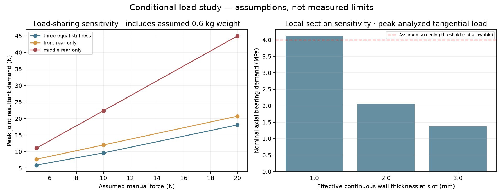
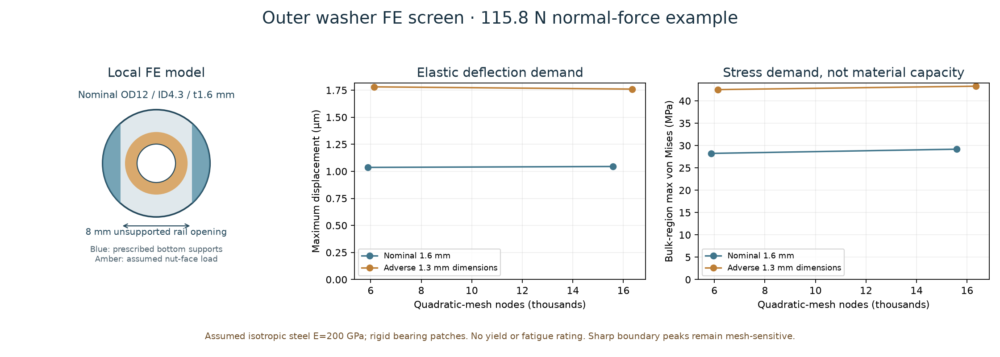

# Conditional load analysis for the core and proposed shoulder-bolt revision

**This is a parameterized analytical and local finite-element study, not a physical load rating.** Eric confirmed that there is no physical cannon and authorized clearly stated load assumptions. No print, purchase, actual force measurement, material test or fatigue test was performed.

The models establish equilibrium, nominal stress demand, finite-contact feasibility and local steel-washer elastic response for explicit inputs. They do not prove the printed assembly's actual strength, friction, dynamic peaks, fatigue life or vortex performance.

## Inputs and ownership

- `parameters.json` owns the analysis assumptions. `analyze_loads.py` reads the nominal source assembly's lower joint centres and cone angle from `../assembly-study/core-assembly.json`, and records that file's hash in `results.json`.
- Coordinates are millimetres, X tangential horizontal, Y up, Z rearward along the air axis. The recovered cone half-angle is approximately 5.49 degrees.
- Load inputs are illustrative **5, 10 and 20 N** manual cases; a separately labelled **40 N** case applies an assumed factor of two to 20 N. These are analysis scenarios, not instructions to install stronger bands and not measured operating limits. Factor two does not bound unmeasured impact or capture-clearance contact peaks.
- Body mass is assumed **0.60 kg**, COM `[0,-20,140]` mm; grasp point `[0,-155,110.4]` mm is a contact assumption supported by the source handle geometry. The 80 mm pull travel is a kinematic assumption.
- All 17 source meshes total about 424,834 cubic millimetres. At a reference PETG density of 1.28 g/cm³ that is about 544 g of full-density geometric material. This is not a slice estimate or a measured mass; infill, added hardware, flexible film and bands change it. See `stock-geometry-mass.json`.
- The proposed joint uses a 5 mm shoulder with M4 threaded end, continuous local collar, keyed inner adapter and metal washers/nut. The current screen credits only **2.0 mm collar-only effective bearing thickness**, not the original wall plus a nominal reinforcement thickness. Key projected bearing width/length are **7.4/15 mm**, recut slot **8.2/16.4 mm**, inner adapter **30 × 22 mm**, minimum base **4.6 mm**, central hole **5.4 mm**.

The upper rail is not treated as a grounded support and the load is not divided by six. No clamp friction or bolt preload is credited for in-plane shear.

## Load paths and cases

Video/mesh evidence identifies two opposite front-annulus elastic anchors leading to a central junction, followed by two parallel bands to the moving rear central cap. There are no elastic anchors on the handle or upper rail. The central film clamp moves; the rear annular clamp bounds the film. Band rest lengths and stiffness are unknown.

The fourteen planar cases include axial pull, normal/inverted gravity, a two-g carry sensitivity, and positive/negative ten-degree pull directions at both 20 and 40 N. A separate 3D screen adds sideways forces and combines them with the 40 N off-axis directions. These treat the whole toy including the moving cap as quasi-static; internal band/film force sharing is not used to reduce the external hand-load wrench.

### Planar force and moment equilibrium

`analyze_loads.py` solves the lower handle's three connection reactions under an explicitly assumed equal point-joint stiffness model. It also evaluates front/rear-only and middle/rear-only participation sensitivities. The pair cases are adverse sensitivity cases, not permission to use an incompletely assembled cannon. Minimum-norm reactions are not guaranteed real load sharing.

| Assumed case | All three lower connections | Front/rear pair | Middle/rear pair |
|---|---:|---:|---:|
| 1 N axial unit load, no gravity | about 0.97 N peak | about 1.02 N | about 2.44 N |
| 20 N axial plus 0.60 kg gravity | about 18.1 N peak | about 20.7 N | about 44.9 N |
| 40 N transient example plus gravity | about 37.5 N peak | about 38.9 N | about 91.8 N |
| 40 N at −10 degrees plus gravity | about 45.8 N peak | about 50.9 N | about 116.2 N |

Final values are in `results.json`; small assembly datum refinements can change the rounded table. Numerical balance is checked, but it does not validate the assumed support stiffness.

The source-supported grip assumption needs about **3.27 N·m counter-moment** to hold aim statically under the 20 N axial-plus-weight case; the 40 N example needs about 6.37 N·m. This is neither a comfort assessment nor a measured hand reaction. Each 10 mm shift of the grasp toward the air axis reduces the aligned 20 N pull moment by 0.20 N·m. That gives a quantitative reason to study hand placement without claiming better ring formation.

### Local nominal demand

For each reaction the program resolves force into the actual conical normal and axial tangent. The largest analyzed normal component is about **116 N**, and the largest tangential component about **30 N**, in the adverse middle/rear-only 40 N at −10 degrees case. They are not assumed to be evenly shared among six fasteners.

- Axial slot-edge bearing is `Ft / (effective thickness × key projected width)`. With 2.0 mm continuous collar-only section and 7.4 mm key width the largest nominal demand is about **2.05 MPa**. A 1 mm section would require about 4.11 MPa in the same simplified scenario. A wider loose washer alone does not improve this in-plane bearing area.
- Two-ligament shear-out and local net-section demands are also reported, with explicit 5/10/15 mm edge-distance sensitivity. These are nominal section formulas; local notch, layer and collar-transition stresses are unresolved.
- A one-way simply-supported bridge proxy for the 4.6 mm inner adapter spans the 8.2 mm opening and uses net width `30−5.4=24.6 mm`. At the largest normal component it gives about **2.74 MPa** bending and **0.0067 mm** deflection at assumed E=1000 MPa. This is not 3D curved-pad contact analysis.
- The M4 thread's nominal tensile stress and the 5 mm shoulder's nominal shear are reported separately. Their combined nominal demand peaks around 13.3 MPa in the planar cases, before shoulder bending, thread notch and bearing details. No hardware load rating follows.

Analyst-selected 4 MPa nominal and 2 MPa shear screening thresholds are included for sensitivity only. They are not manufacturer allowables, measured printed strength or a factor of safety.

## 3D frictionless finite-contact equilibrium

`contact_wrench_screen.py` uses nonnegative normal forces on separate axial/cross-key bearing faces and opposing positive-capture pad faces. It balances all six force/moment components without friction. Contact areas and a pad bridge limit are explicitly assumed. A linear program asks whether **some** balanced reaction set exists within those assumptions; it does not establish that actual stiffness will select it.

A unit sideways pull at the moving centre creates approximately **140 N·mm about the lower connector row**. Finite key/pad bearing must resist that roll; treating the narrow row as a full 3D point support can hide the problem. The contact model finds feasible normal-force equilibria for all stated axial/sideways cases and all stated support sets. The minimum possible fraction of assumed limits is an optimistic demand metric, **not** an inverse safety factor.

Normal capture is conditional on the final CAD and real hardware proving that the shoulder/head/washer/nut trap the stack after capture play closes. The screen does not resolve creep, impact through clearance, contact compliance, bolt bending or fatigue. `contact-wrench-results.json` retains the reactions and all qualifications.

## Actual local finite-element washer model

`washer_fea.py` uses installed **Gmsh 4.15.0 and CalculiX 2.23**, quadratic ten-node tetrahedra, to model the outer steel washer bridging the rail's 8 mm opening. This is an actual 3D solid elasticity solve, not an FEA image substituted for physical proof.

Assumptions: isotropic steel E=200 GPa, Poisson ratio 0.3; bottom-face support strips outside `|X|=4 mm`; only minimal in-plane rigid-body restraints; a normalized 1 N downward nut-face load on an annular patch up to radius 3.5 mm. The selected mesh load area is recorded and normalized to exactly 1 N. The rail/nut contacts are prescribed rigid patches, not solved nonlinear contact. **No washer yield strength or grade capacity is assumed.**

| Geometry, finer mesh | Max displacement per N | Bulk-region max von Mises per N | Full max per N |
|---|---:|---:|---:|
| Nominal OD12 / ID4.3 / t1.6 mm | 0.00000902 mm | 0.252 MPa | 0.465 MPa |
| Adverse dimensions OD11.3 / ID4.48 / t1.3 mm | 0.0000152 mm | 0.374 MPa | 0.689 MPa |
| Thin comparison OD12 / ID4.3 / t1.0 mm | 0.0000241 mm | 0.507 MPa | 0.678 MPa |

Nominal displacement changed less than 1% and bulk maximum about 3.3% between target element sizes 0.65 and 0.45 mm. Adverse-dimension displacement changed about 1.2% and bulk maximum about 1.8% between 0.60 and 0.40 mm. Support reactions balance 1 N within 0.000001 N.

At the approximately 116 N adverse normal demand, these linear models scale to about **29.2/43.3 MPa bulk stress** and **0.00104/0.00176 mm maximum displacement** for nominal/adverse dimensions. The full maxima are about 53.8/79.8 MPa at the studied meshes. Sharp support/load boundary peaks increase on refinement and are not converged yield evidence. The stated bulk region excludes points within 0.30 mm of those ideal boundaries; this exclusion is explicit, not an assertion those locations are harmless.

The thin comparison was solved at one mesh and is not independently convergence qualified. A finer 0.30 mm nominal run did not finish within its solver time limit; it is excluded from the reported accepted cases. The two completed mesh levels establish only the stated limited convergence evidence. Actual washer material, yielding, nut seating and rail compliance remain physical/design inputs.

## Elastic anchor and central loop screen

`band_path_screen.py` expresses branch force per unit elastic resultant with front-anchor half-spacing 72.73 mm. Junction distances 60/100/160/240 mm are sensitivity assumptions, not rest-length or equilibrium predictions. For axial elastic resultant F, each front tension is `F sqrt(a²+d²)/(2d)` and each rear parallel band carries F/2.

At assumed F=40 N and d=60 mm, each front branch needs about 31.4 N, comprising 20 N axial and 24.2 N inward radial. Ancillary mesh cuts found about 38.51 mm² in each front anchor's combined legs, 16.96 mm² in its crown section, and 53.26 mm² in the central cap crown. Corresponding simple average direct demands are about 0.52 MPa axial at the front legs, 1.43 MPa radial at the front crown and 0.75 MPa at the central cap section. **Curved-arch bending, band/finger contact and stress concentration are not established by area division.** The unchanged anchors cannot be declared proven from these averages.

## Sources and outstanding proof

- [Official Bambu PETG HF TDS](https://store.bblcdn.com/3a230e260a3a47c2b0db0156e07eef91.pdf) reports directional test data, density and reference modulus. Its specimens were 100% infill and conditioned/annealed; its values are comparison references, not the actual toy's allowables.
- [Elesa ISO7379 shoulder-screw data](https://www.elesa-ganter.hr/siteassets/PDF/EN/ISO%207379.pdf) supplies hardware dimensions and shoulder length tolerance. It warns against deriving tightening torque from property class alone because shoulder/transition contact limits it.
- [Accu DIN7349 M4 washer](https://www.accu.co.uk/metric-flat-washers/63172-HDTW-M4-A2) supplies the final nominal and dimensional-tolerance cases used here. Washer strength has not been independently certified.
- [TR Fastenings stress-area table](https://www.trfastenings.com/knowledge-base/metric-screws/minimum-ultimate-tensile-loads) is the source of the M4 nominal tensile stress area used in the demand calculation.

Remaining proof is explicit: real stack dimensions and capture/removal; printed coupon and section integrity; actual pull-force/travel curve and elastic topology under motion; joint movement and damage under unchanged operation; thread retention; transient response and life. No force, drop, fatigue, toy-safety, aim, coherence or range rating is claimed.

The lightweight handoff consists of this README, Python sources, parameters/results JSON and PNG plots. Raw mesher/solver intermediates under `washer-fea/` can be regenerated and need not be bundled in the main design ZIP.
