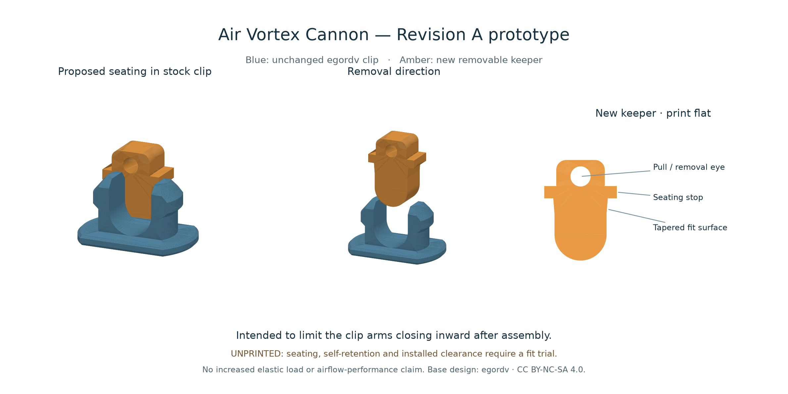

# Air Vortex Cannon — Revision A

**Unprinted fit prototype, 2026-10-25.** This is a small retention update to [egordv's Air Vortex Cannon, designer profile 348811](https://makerworld.com/en/models/442826-air-vortex-cannon#profileId-348811). It adds a removable keeper to the stock split clip. The intended benefit is to limit the arms closing inward and releasing after assembly. Fit, self-retention, installed clearance and durability remain unverified.

## What changed

- A new independently parameterized keeper fills most of the stock clip's U-shaped gap after the clip is installed.
- Rounded leading foot, tapered upper fit surface, seating stop, and a pull eye for deliberate removal.
- Two fit candidates: **clearance 8.9 mm** and **nominal 9.0 mm** at the seating edge. The source gap measures 9.0 mm. These correspond to **0.10 mm and 0.00 mm total width clearance**, respectively, before manufacturing error. Neither is an intentionally oversized interference fit.
- Keeper depth is 6.8 mm versus the source clip body's 7.3 mm: **0.50 mm total depth clearance**, or 0.25 mm per face when centered.
- Both keepers are about **12 × 16.60 × 6.8 mm** in the supplied flat print orientation. A flat profile gives a 6.8 mm print height, with no designed unsupported overhang. Actual layer preview remains pending.

After a successful trial, the intended quantity is one keeper per installed stock clip (six for the full stock assembly), using the selected fit variant. This is not a direction to print six before testing one.

The existing shells, outlet, elastic system, membrane clamps, handle and sights retain their original geometry. No stronger elastic, extra pull travel or airflow-performance improvement is claimed.

## Files

| File | Purpose |
|---|---|
| `build_revision.py` | Editable native parameter source using build123d 0.11.1; `Spec` owns new keeper geometry. |
| `parts/keeper-clearance.stl`, `.step` | Start with this 8.9 mm fit candidate. |
| `parts/keeper-nominal.stl`, `.step` | 9.0 mm candidate if the first is too loose; never force a fit. |
| `parts/stock-pin-reference.stl` | Original pin with rigid translation only, for a small fit trial. |
| `parts/stock-pin-side-trial.stl` | Same original pin rotated 90 degrees for a layer-orientation comparison; supports under the raised body require slicer review. |
| `validation.json` | Dimensions, export round trip, mesh checks, hashes, scoped source-mesh contact check and remaining limits. |
| `render_revision.py` | Recreates the views and contact samples from delivered meshes. |
| `revision-a-review.png` | Seated and exploded views of the new keeper against the actual stock pin mesh. |
| `../source/egordv/` | Unmodified downloaded base meshes and source inventory. |

STL coordinates are millimetres at **100% scale**. STEP declares CAD units. Do not scale the whole model to tune fit; change the keeper's interface dimensions in its parameter source.

## Proposed smallest fit trial

No print has been started. Before a complete build, the useful physical trial is one stock clip and the clearance keeper, in the intended filament. Use a contrasting available colour for the small removable keeper. The original designer used PETG; current filament availability and the receiving 0.4 mm slicer profile have not been verified for this revision.

1. Check the source clip for cracks and inspect the cleaned mating surfaces. The keeper cannot repair a fractured clip or shell.
2. On the loose clip, enter the keeper from the open, barbed end. The leading foot should enter by hand and the cap should reach the arm ends without spreading them. Confirm deliberate removal through the pull eye.
3. Invert and gently handle it. A stop cap is **not** a positive lock. If it works loose, this candidate fails the retention trial; do not issue it for use. Record the exact variant/material/orientation and adjust the smallest part.
4. Check access in one actual assembled rail/shell connection. Install the source clip normally first, then the keeper. The new eye extends approximately **6.3 mm beyond the stock clip tips**. Verify room for insertion and removal, full clip seating and clearance from the diaphragm and elastic throughout their normal motion.
5. Inspect the stock shell slot and surrounding wall after gentle handling. The tapered shell is about 1 mm thick; preventing clip release can transfer load into that wall. No increased elastic-load rating follows from adding the keeper.

If the 8.9 mm candidate is too loose, the 9.0 mm candidate is available for another hand-fit trial. Do not hammer it, stretch the clip to admit it, or use the keeper to force an incompletely seated joint. Any whitening, cracking, persistent spreading, fallout or inaccessible removal is a failed trial.

## What has been checked

The source clip's U void is 9.0 mm wide, with an R4.5 mm lower semicircle centred 6.5 mm above its base. Its body depth is 7.3 mm. These are mesh-derived dimensions, not caliper readings of a print. The source rail and shell slots have tapered/chamfered profiles; no simplified rectangular mating coupon substitutes for the real connection.

New parts are single valid CAD solids. Exported STLs are watertight, consistently wound and single-component. STEP re-import retains volume within 0.01 cubic millimetres. The new part bounds fit the verified X2D main-hotend **256 × 256 × 260 mm** envelope. Source meshes remain unchanged.

The contact check samples delivered keeper surfaces against the actual source pin in the assumed seated position, including dense samples along their centre-plane section. It does not prove a complete interference-free assembly, insertion under flexure, print tolerance or physical retention. Slicing and a profile-bearing 3MF are not part of this CAD prototype. No print time, filament mass, fatigue life, range, aim or ring-coherence gain is established.

## Next design suggestions

After a successful joint trial, prioritize a repeatable centred diaphragm pull, checks of seam sealing and alignment, and grip/sight calibration. Compare those at unchanged comfortable effort before changing the outlet. Keep aerodynamic variants separate so their effects can be measured against the stock baseline.

## Attribution and license

Base: **egordv, Air Vortex Cannon**, MakerWorld profile 348811, downloaded 2026-10-25. [Original model](https://makerworld.com/en/models/442826-air-vortex-cannon#profileId-348811). [CC BY-NC-SA 4.0](https://creativecommons.org/licenses/by-nc-sa/4.0/).

Changes: new keeper geometry, parameter source, rigidly reoriented pin references, views and validation for Eric Feunekes, prepared with Codex, 2026-10-25. This revision is offered under the same **CC BY-NC-SA 4.0** terms. No separate community lock geometry was incorporated. In particular, Schello's separately restricted lock files were not used.
